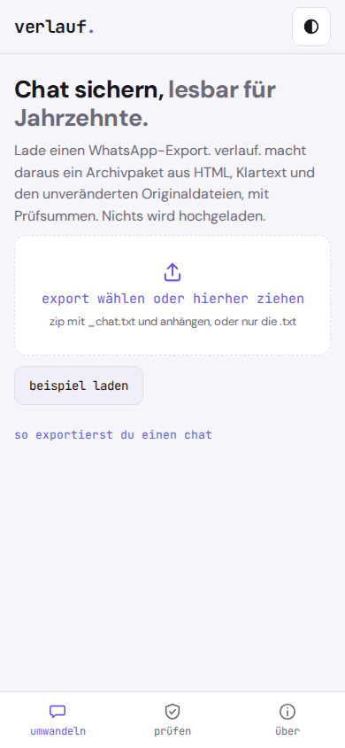
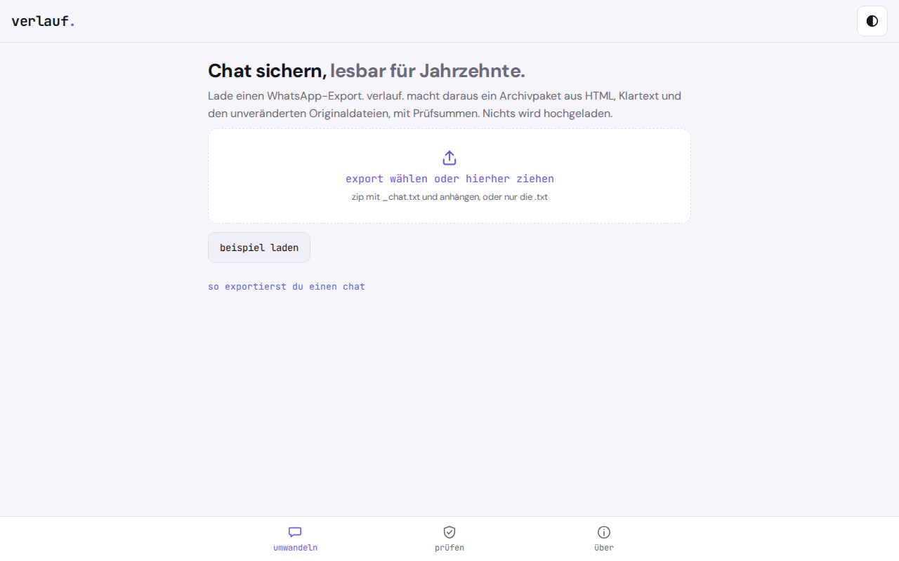

# verlauf.

**Wer kann deinen Chat in zwanzig Jahren noch lesen?** verlauf. macht aus einem WhatsApp-Export ein Archivpaket, das auch ohne die App lesbar und prüfbar bleibt.

Familien- und Freundeschats leben in einer App. Der Export ist eine `_chat.txt` mit Anhängen in einem ZIP, deren Datumsformat je nach Sprache, Plattform und App-Version wechselt und nirgends beschrieben ist. Wer das Telefon wechselt, das Konto verliert oder stirbt, hinterlässt Chats, die keiner mehr öffnen kann. verlauf. wandelt den Export in schlichtes HTML ohne JavaScript, normalisierten Klartext und maschinenlesbare Nachrichten um, legt die Originaldateien unverändert bei und schreibt eine Prüfsummenliste im Format von `sha256sum`. Eine Formatbeschreibung liegt im Paket.

Reine Rechnung im Browser, keine KI, kein Server. Alles bleibt auf deinem Gerät.

<p align="center">
  
  
</p>

## Warum

Das Anzeigen von WhatsApp-Exporten ist nicht neu, es gibt freie Anzeiger und Umwandler. Was fehlt, ist ein **Archivpaket**, das sich selbst erklärt und sich später mit Standardwerkzeugen prüfen lässt, auch ohne verlauf. Neu ist die Verbindung aus Normalisierung, Selbstbeschreibung und Prüfbarkeit für Laien. Die Spezifikation steht in `SPEC.md` (`verlauf-archiv 1`), sodass andere kompatible Werkzeuge bauen können.

## Funktionen

- **Export laden**: ZIP mit `_chat.txt` und Anhängen oder nur die `.txt`, per Dateiauswahl oder Ziehen
- **Zeilenformate** von Android und iOS, Deutsch und Englisch, 12 und 24 Stunden, mit und ohne Sekunden
- **Datumsreihenfolge** (Tag/Monat oder Monat/Tag) wird erkannt. Bleibt sie mehrdeutig, fragt verlauf. mit Beispieldatum in beiden Lesarten, statt still zu raten
- **Vorschau**: Nachrichten, Teilnehmende, Zeitraum, Anhänge gefunden und fehlend, nicht erkannte Zeilen mit Nummern
- **Archivpaket** als ZIP: `LIESMICH.txt`, `chat.html`, `chat.txt`, `nachrichten.jsonl`, `original/` und `pruefsummen.sha256`
- **Archivkennung**: die SHA-256 der Prüfsummenliste, groß angezeigt zum Notieren oder Ausdrucken
- **Prüfen**: Archiv-ZIP laden, alle Prüfsummen nachrechnen, Ergebnis pro Datei `ok`, `geändert`, `fehlt` oder `zusätzlich`, optional Vergleich mit einer notierten Kennung
- **Beispielchat**, erfunden, als Beispiel markiert und mit einem Klick entfernbar
- Hell und dunkel, funktioniert offline, installierbar als App

## Datenschutz

Nichts verlässt dein Gerät. verlauf. hat keinen Server, kein Konto, keine Analyse, keine Werbung und lädt nichts aus dem Netz nach. Dein Chat wird im Arbeitsspeicher des Browsers verarbeitet und nirgends gespeichert. Im Browser liegt nur die Einstellung hell oder dunkel (localStorage). Das Archiv entsteht erst, wenn du es herunterlädst.

Ein Archiv enthält den ganzen Chat im Klartext. Bewahre es so auf, wie du den Chat selbst aufbewahren würdest.

## Installation

verlauf. ist eine statische Web-App. Es gibt keine Abhängigkeiten.

1. Den Ordner auf einen beliebigen statischen Host legen (eigener Webspace, GitHub Pages, ein Raspberry Pi). Für die Installation als App ist HTTPS nötig. `index.html` läuft auch direkt aus dem Dateisystem.
2. Die Adresse im Browser öffnen.
3. Im Browsermenü **Zum Startbildschirm hinzufügen** wählen. Danach startet verlauf. wie eine App und funktioniert auch ohne Netz.

Lokal testen:

```
python3 -m http.server 8000
```

Dann `http://localhost:8000` im Browser öffnen.

Die Logik liegt in `verlauf.js`. `node bauen.js` kopiert sie in `index.html`, damit die Seite ohne Server läuft. Tests: `node --test`.

## Wie es funktioniert

Die vollständige Beschreibung steht in `SPEC.md`, die Referenzimplementierung ist `verlauf.js` (ein ES-Modul ohne Abhängigkeiten, nur Standardbibliothek von Browser und Node). Kurz:

- **Lesen.** Der Export wird als UTF-8 gelesen. BOM, CRLF, unsichtbare Richtungszeichen und schmale Leerzeichen werden normalisiert. Eine Zeile mit Datum und Uhrzeit beginnt eine neue Nachricht, alle anderen Zeilen hängen an die vorige an. Zeilen vor der ersten Nachricht und Zeilen mit unmöglichem Datum werden offen gemeldet.
- **Datumsreihenfolge.** Ist irgendwo das erste Feld größer als 12, gilt Tag/Monat, ist das zweite größer als 12, gilt Monat/Tag. Sonst heißt der Punkt als Trenner Tag/Monat, der Schrägstrich ist unsicher, und die Oberfläche fragt.
- **Paket.** ZIP ohne Kompression, damit es auch mit einfachen Werkzeugen lesbar bleibt. `chat.txt` und `nachrichten.jsonl` sind normiert und byte-genau beschrieben. `chat.html` und `LIESMICH.txt` dürfen sich zwischen Implementierungen unterscheiden.
- **Prüfsummen.** `pruefsummen.sha256` funktioniert mit `sha256sum -c pruefsummen.sha256` im entpackten Paketordner. Sortiert wird nach UTF-8-Bytes.
- **Testvektoren.** `testvektoren.json` enthält Parserfälle, bekannte SHA-256- und CRC-32-Werte und einen Prüfsummenfall, in dem UTF-8- und UTF-16-Sortierung auseinanderfallen. Nachrechnen mit `node --test`.

**Bekannt und getestet:** die Zeilenformate oben, der Rundlauf Umwandeln, Zurücklesen, Prüfen, die Testvektoren.

**Grenzen:**

- Nur WhatsApp. Andere Messenger sind nicht vorgesehen, die Spezifikation lässt Raum dafür.
- Weitere Sprachen und Datumsvarianten (etwa Französisch oder Spanisch) sind nicht geprüft und werden nicht erkannt. Was nicht passt, wird als nicht erkannt gemeldet.
- Zeiten sind Ortszeit des Geräts ohne Zeitzone und werden unverändert übernommen.
- Kein Entschlüsseln, kein Auslesen von Telefon-Datenbanken, keine Bearbeitung.
- Kein ZIP64: Archive über 4 GB werden abgelehnt, ab 1 GB gibt es eine Warnung. Das ZIP entsteht im Arbeitsspeicher, große Exporte mit vielen Videos können am Handy zu groß sein.
- ZIPs mit Kompression lesen nur Browser mit `DecompressionStream`. Sonst geht nur die `.txt`.
- **Prüfsummen sind keine Signatur.** Sie belegen Unverändertheit nur gegenüber einer Liste, die du sicher aufbewahrst. Wer Dateien und Liste gemeinsam fälscht, wird nicht erkannt. Bewahre die Archivkennung getrennt vom Archiv auf.
- Ein Export ohne Medien oder mit gekürztem Verlauf bleibt unvollständig. verlauf. archiviert nur, was im Export steht.

**Vermutung, nicht bewiesen:** Dass HTML ohne Skript und UTF-8-Klartext in Jahrzehnten lesbar bleiben, ist eine begründete Annahme. Ob Laien die Archivkennung tatsächlich getrennt aufbewahren, ist offen.

## Lizenz

GNU Affero General Public License v3.0 (AGPL-3.0), siehe `LICENSE`.

---

**gedacht.gemacht.** Kleine, ehrliche Software. Alles bleibt auf deinem Gerät.
